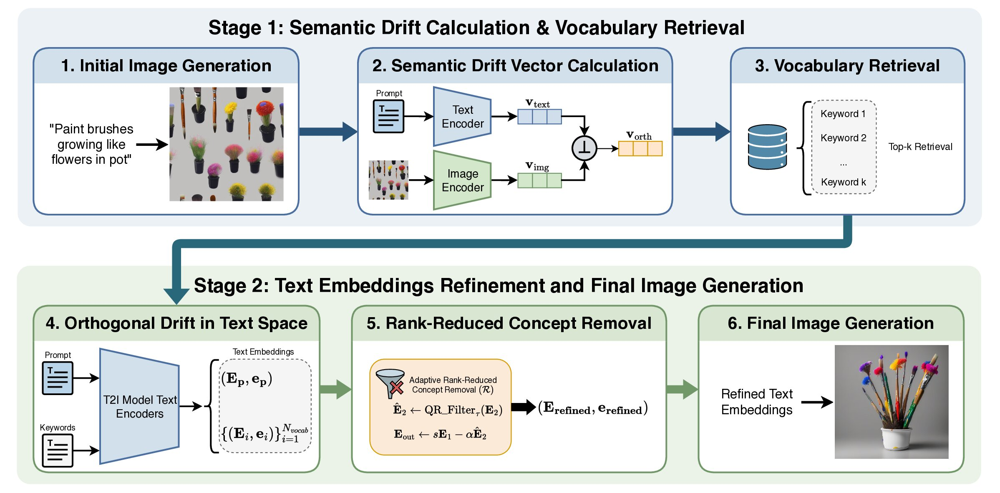
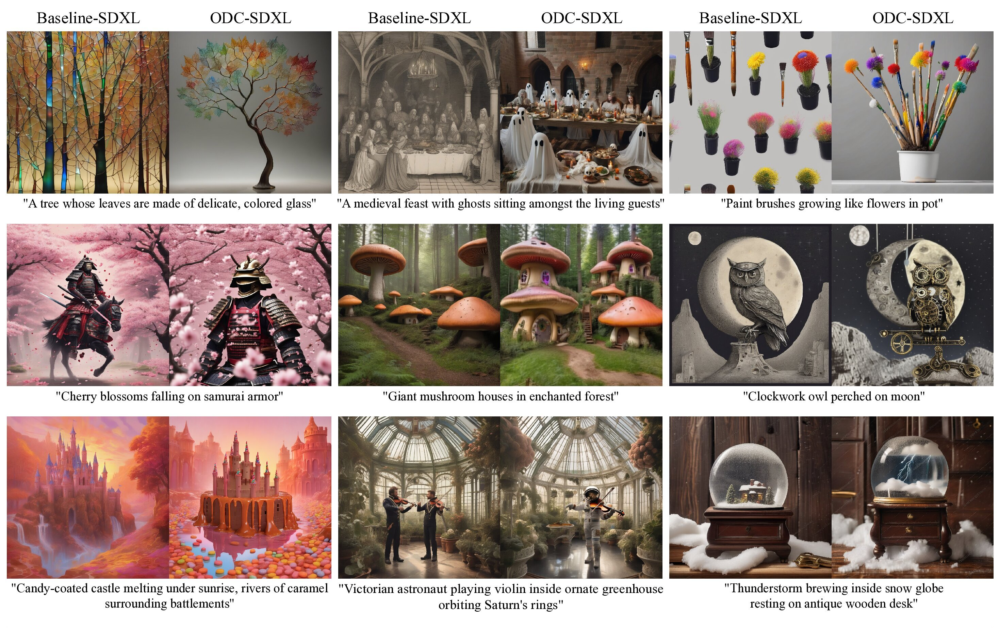

<div align="center">

# ODC: Orthogonal Drift Correction for Improved Text-to-Image Semantic Alignment at Inference

[](https://openreview.net/forum?id=BOdxfPdtjE)
[](https://opensource.org/licenses/MIT)

**Kasra Kamali, Basim Azam, Tuan Duong Trinh, Jean Honorio, Naveed Akhtar**  
School of Computing and Information Systems, The University of Melbourne

</div>

## Abstract

> Text-to-image models have achieved remarkable success in generating high-quality images from textual descriptions. However, they often struggle with ``semantic drift,'' where the generated output fails to precisely align with complex or nuanced text prompts. While recent approaches have attempted to address semantic errors regarding attribute binding or object presence, there remains a gap for a more holistic method that addresses these issues by directly refining the text embeddings of the initial user prompt. In this work, we introduce Orthogonal Drift Correction (ODC), an inference-time guidance method designed to mitigate semantic drift without requiring model retraining or additional user inputs. ODC guides image generation through a two-stage process. In the first stage, it identifies the semantic drift by evaluating the initially generated image against the user prompt in a shared vision-language embedding space. It then isolates the component of this drift vector that is orthogonal to the prompt's direction and translates it back into text via a vocabulary-based surrogate mechanism. In the second stage, it produces refined text conditioning for a second generation pass by feeding both the initial text embedding and the re-embedded drift representation into an adaptive rank-reduced concept removal module. Our experiments demonstrate that ODC consistently improves prompt-image alignment, increasing CLIP scores by up to 5.4% over the baseline on the $COALBench-300$ and PartiPrompts benchmarks. Furthermore, on the T2I-CompBench complex subset, ODC improves the average 3-in-1 score by 4.5% over the competing methods. As a plug-and-play module, ODC offers a practical and efficient method for improving the reliability of text-to-image models.

<p align="center">
  
</p>

## Installation & Setup

### 1. Environment Setup

```bash
# Create and activate virtual environment
python3 -m venv odc
source odc/bin/activate  # On Windows: venv\Scripts\activate

# Install dependencies
pip install --upgrade pip
pip install -r requirements.txt

# Download spaCy English language model
python -m spacy download en_core_web_sm
```

### 2. Vocabulary Preparation

Build the vocabulary and precompute the BLIP-2 embeddings locally:

```bash
python prepare_vocab.py
```
*This will generate `data/keywords.pkl` and `data/keywords_emb_blip2_mean.pt` on your machine.*

## Quickstart Demo

For a quick visual comparison on a single prompt, run the demo notebook:

```bash
jupyter notebook demo.ipynb
```

### Qualitative Results

<p align="center">
  
</p>

## Reproducing Experiments

### 1. Generate Image Pairs
Generate paired baseline and ODC enhanced images across COALBench-300 prompts (`src/data.py`) and different seeds:

```bash
# Run full SDXL benchmark
python run_experiment.py \
    --model sdxl \
    --alpha 1.0 \
    --output_dir ./results/sdxl_experiment
```

All images are saved in the output directory as paired comparisons:
* `{index}_0.png`: Standard generation
* `{index}_1.png`: ODC

### 2. Quantitative Evaluation
Compute CLIP and BLIP-2 alignment scores along with paired t-test statistics:

```bash
python evaluate.py \
    --output_base ./results/sdxl_experiment \
    --metrics clip blip \
    --save_json evaluation_results.json
```
